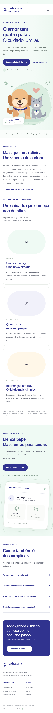
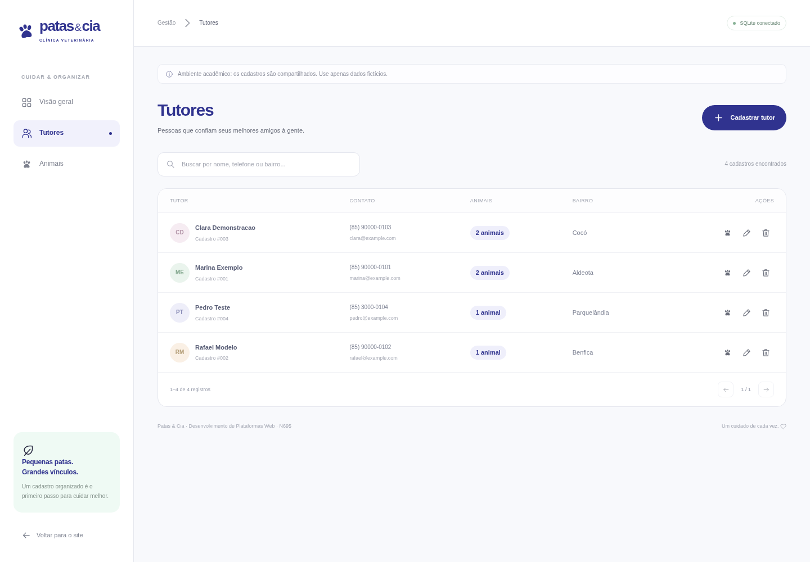
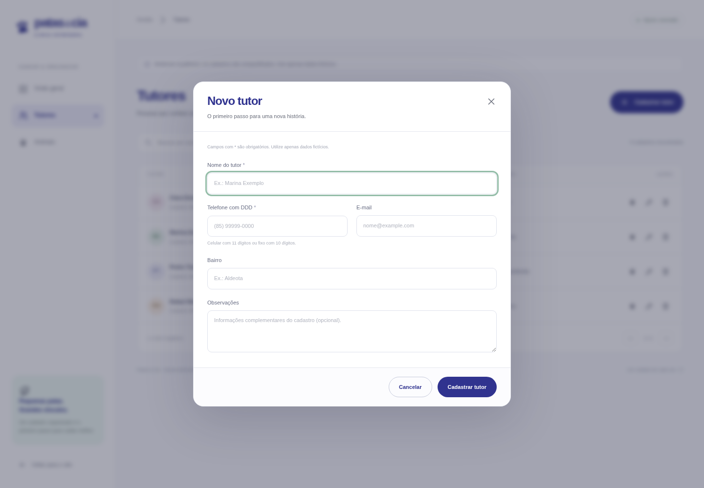
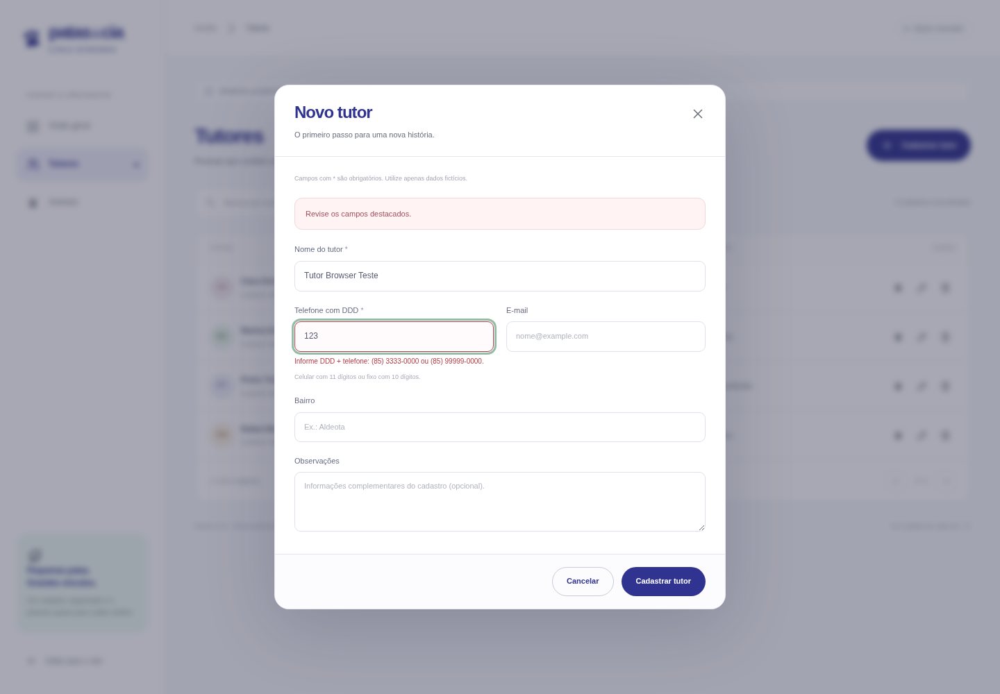
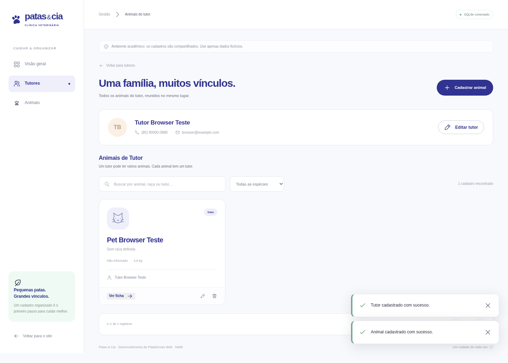
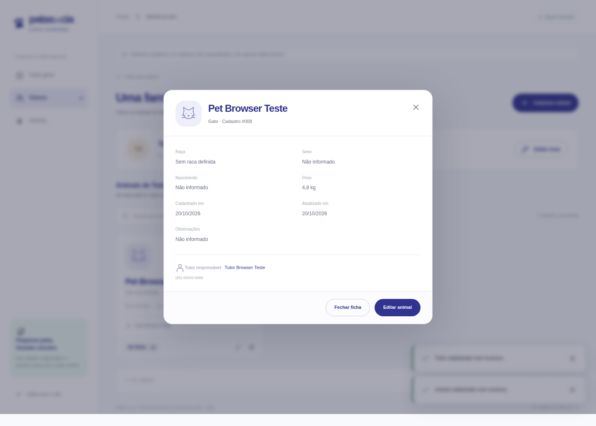
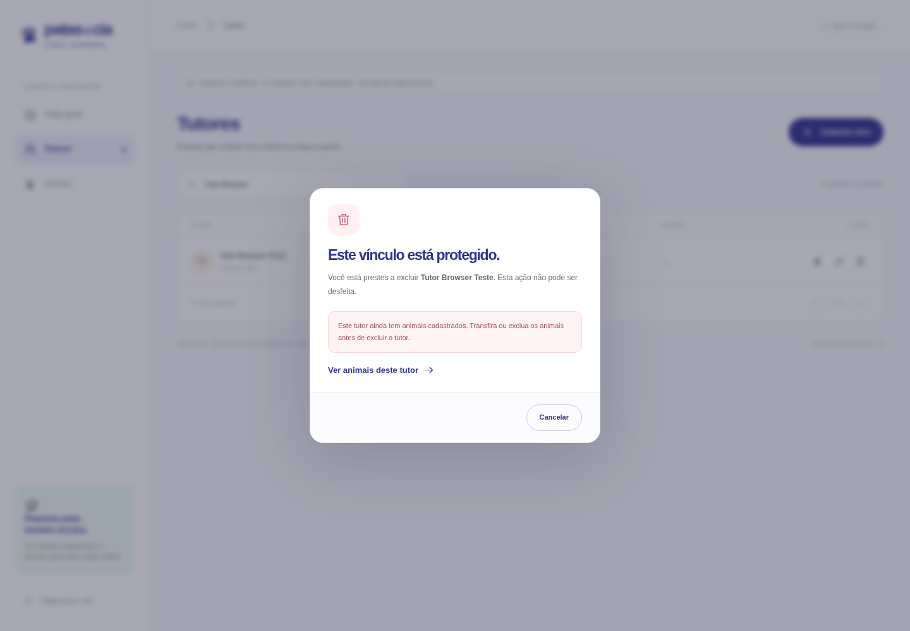
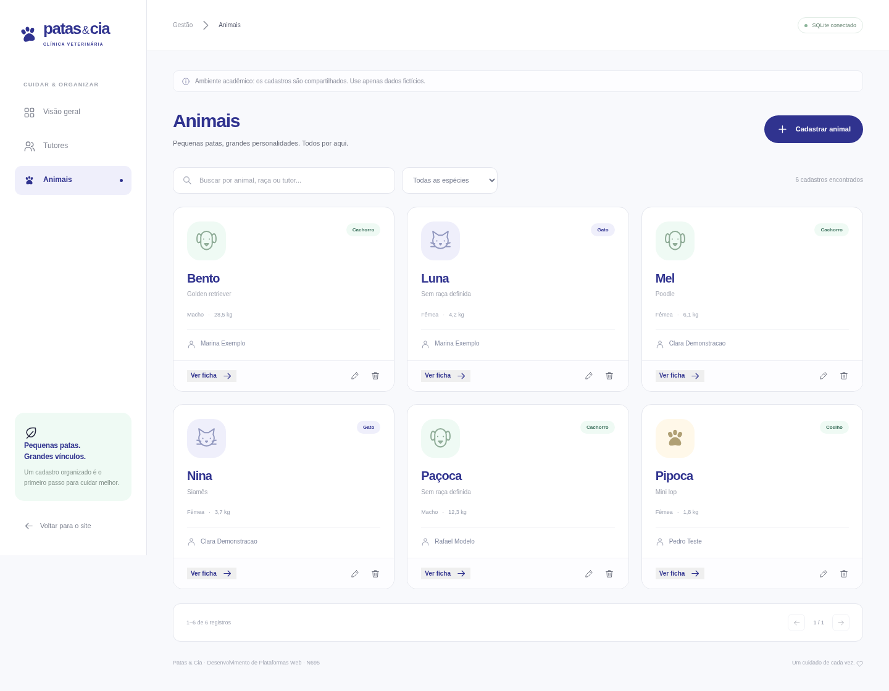
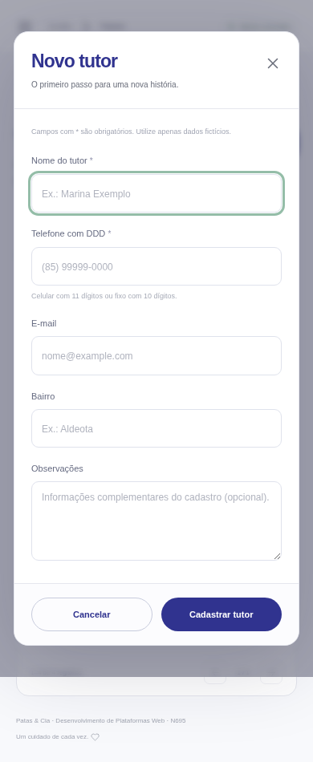

# 🐾 Patas & Cia

Sistema web para gerenciamento de tutores e animais, desenvolvido para a disciplina **N695 - Desenvolvimento de Plataformas Web**, da Universidade de Fortaleza.

O projeto foi desenvolvido com base no **Cenário 1 - Clínica veterinária de bairro**.

---

## 🌐 Acessos

### Aplicação publicada
https://kayodias-patas.alwaysdata.net

### Painel de gerenciamento
https://kayodias-patas.alwaysdata.net/painel.html

### Repositório
https://github.com/kayodias-dot/patas-e-cia

---

# 📸 Visão geral

## Página inicial


A página inicial apresenta a identidade visual da clínica, informações institucionais e acesso ao painel de gerenciamento.

O layout foi desenvolvido de forma responsiva, permitindo o acesso tanto por computadores quanto por dispositivos móveis.

---

## Versão mobile



A interface foi adaptada para diferentes tamanhos de tela, mantendo a navegação e os elementos principais acessíveis em smartphones e tablets.

---

# 📊 Painel de gerenciamento


O painel centraliza o acesso às principais funcionalidades da aplicação.

Entre as informações disponibilizadas estão:

- quantidade de tutores cadastrados;
- quantidade de animais cadastrados;
- atalhos de navegação;
- acesso rápido aos cadastros;
- pesquisa de registros.

---

# 👤 Gerenciamento de tutores

## Lista de tutores



A aplicação permite visualizar e pesquisar os tutores cadastrados.

Cada tutor pode possuir um ou vários animais vinculados.

---

## Cadastro de tutor



O cadastro de tutor contém os dados necessários para identificação do responsável pelo animal.

Entre os dados utilizados estão:

- nome;
- telefone;
- informações complementares.

---

## Validação de telefone



O sistema valida o formato do telefone antes de permitir o cadastro ou atualização do tutor.

Mensagens claras são apresentadas ao usuário quando algum dado informado é inválido.

---

# 🐶 Gerenciamento de animais

## Animais vinculados ao tutor



Cada animal precisa estar associado a um tutor.

A aplicação permite visualizar os animais pertencentes a determinado responsável.

---

## Ficha do animal



A ficha apresenta as principais informações cadastradas sobre o animal.

Entre elas:

- nome;
- espécie;
- raça;
- tutor responsável.

---

# 🚫 Regra de exclusão



Uma das principais regras de negócio do cenário é impedir que um tutor seja excluído enquanto possuir animais cadastrados.

Quando o usuário tenta realizar essa operação, o sistema bloqueia a exclusão e apresenta uma mensagem informando o motivo.

---

# 🐾 Lista geral de animais



A aplicação também possui uma listagem geral dos animais cadastrados.

A partir dessa tela é possível visualizar, editar ou excluir os registros permitidos.

---

# 📱 Formulário responsivo



Os formulários também foram adaptados para dispositivos móveis.

---

# 🎯 Objetivo do projeto

A Clínica Patas & Cia precisava substituir o controle manual de tutores e animais por uma solução web simples, organizada e acessível.

A proposta da aplicação é permitir o gerenciamento digital dessas informações, mantendo o relacionamento entre tutores e animais e aplicando regras de validação para evitar inconsistências.

---

# ✅ Funcionalidades

## Tutores

- cadastrar tutor;
- listar tutores;
- pesquisar tutores;
- editar tutor;
- excluir tutor;
- validar telefone;
- impedir exclusão de tutor com animais cadastrados;
- visualizar os animais vinculados a cada tutor.

## Animais

- cadastrar animal;
- listar animais;
- editar animal;
- excluir animal;
- vincular animal a um tutor;
- visualizar ficha do animal;
- transferir vínculo para outro tutor quando necessário.

## Interface

- layout responsivo;
- compatibilidade com desktop e dispositivos móveis;
- mensagens de sucesso;
- mensagens de erro;
- navegação entre área institucional e painel;
- painel com indicadores;
- pesquisa de registros.

---

# 🛠️ Tecnologias utilizadas

## Front-end

- HTML5
- CSS3
- JavaScript
- ES Modules
- Interface responsiva

## Back-end

- Node.js
- JavaScript
- API REST própria

## Banco de dados

- SQLite

## Hospedagem

- alwaysdata

## Controle de versão

- Git
- GitHub

---

# 🗂️ Estrutura do projeto

```text
patas-e-cia/
│
├── public/
│   ├── assets/
│   ├── css/
│   ├── js/
│   ├── index.html
│   └── painel.html
│
├── server/
│   ├── app.mjs
│   ├── database.mjs
│   ├── errors.mjs
│   ├── http.mjs
│   ├── index.mjs
│   ├── repository.mjs
│   ├── security.mjs
│   └── seed.mjs
│
├── database/
│   └── schema.sql
│
├── data/
│
├── docs/
│   ├── API.md
│   ├── MODELO_ENTREGA.md
│   ├── PUBLICACAO.md
│   ├── REFERENCIAS_VISUAIS.md
│   ├── REQUISITOS.md
│   ├── TESTES.md
│   └── evidencias/
│
├── tests/
│   ├── api.test.mjs
│   └── validation.test.mjs
│
├── package.json
├── Dockerfile
├── README.md
└── INICIAR_WINDOWS.bat