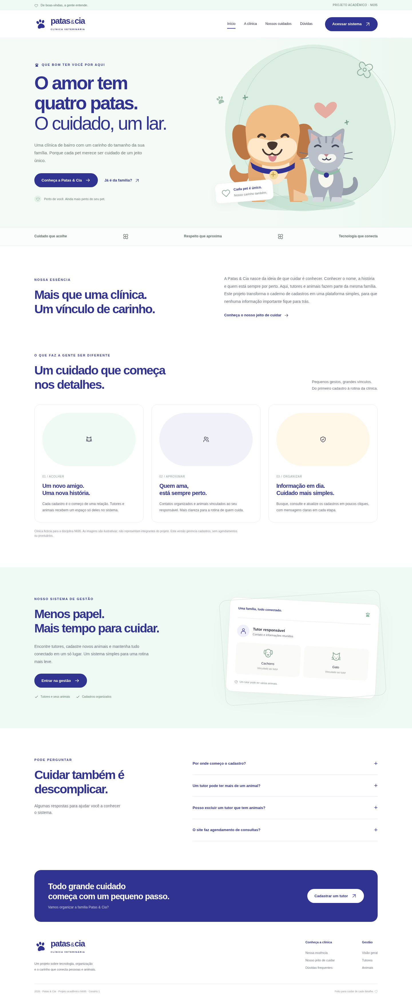
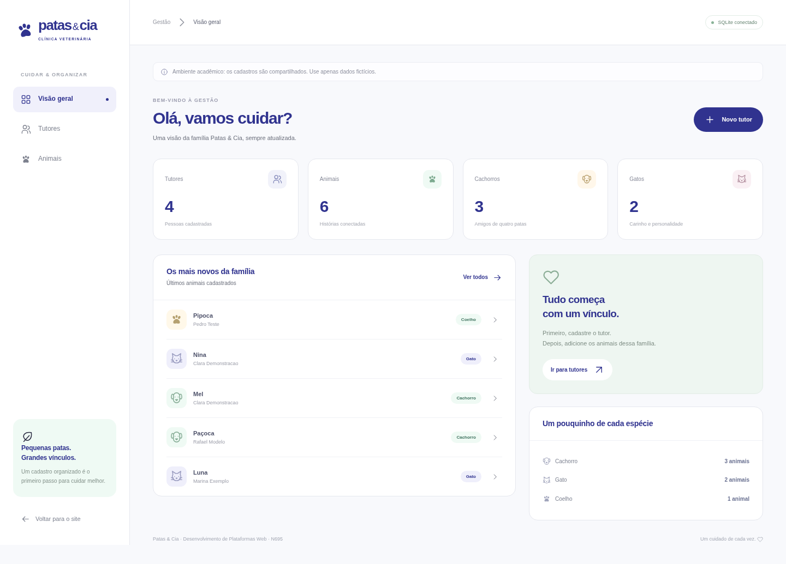

# Patas & Cia

Site institucional e sistema de gestão de tutores e animais. Projeto acadêmico N695, cenário 1.

**[Leia as instruções completas de instalação e uso](LEIA-ME.md).**

Node.js 22.13 ou superior (recomendado: 24). Sem dependências externas para instalar. Banco de dados SQLite criado automaticamente.

```bash
npm run seed  # opcional: dados fictícios de demonstração
npm start
```

Abra `http://localhost:3000`. No Windows, também é possível usar `INICIAR_WINDOWS.bat`.

## Prévias





## Documentação

[Requisitos](docs/REQUISITOS.md) | [API](docs/API.md) | [Testes](docs/TESTES.md) | [Publicação](docs/PUBLICACAO.md) | [Modelo de entrega](docs/MODELO_ENTREGA.md) | [Referências visuais](docs/REFERENCIAS_VISUAIS.md)

**Limites:** demonstração sem autenticação, apenas para dados fictícios. Ainda não publicado. O modelo de documentação precisa ser completado pela equipe. As fotos externas da referência devem ser substituídas por material próprio/licenciado ou removidas antes da publicação.
